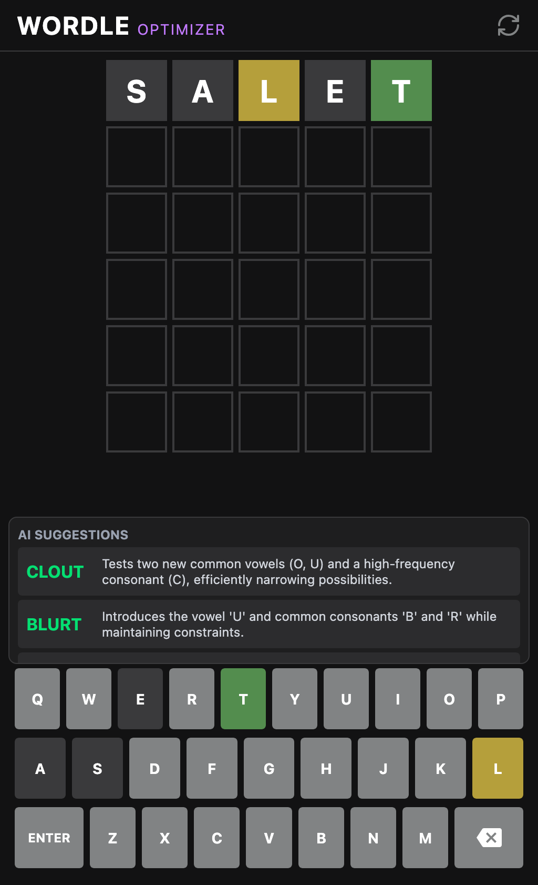

# Wordle Optimizer AI

Demo: https://wordle-optimizer.jeeyo.workers.dev/

**Wordle Optimizer AI** is an intelligent companion app designed to help you solve Wordle puzzles more efficiently. It uses OpenAI's **gpt-6-luna** model to analyze your current game state and provide statistically optimal word suggestions.

Unlike simple solvers that just list matching words, this optimizer considers information theory (entropy) to suggest words that will eliminate the most possibilities, even if they aren't the final answer.

## 📸 Screenshot




## ✨ Features

- **🤖 AI-Powered Analysis**: Uses OpenAI to analyze board state (Green/Yellow/Gray tiles) and suggest the best next moves.
- **🧠 Strategic Reasoning**: Provides a brief explanation for *why* a word is suggested (e.g., "Eliminates common vowels," "Tests specific positions").
- **🎨 Interactive Grid**: Replicates the familiar Wordle interface. Type your guess, then tap tiles to toggle their colors to match your actual game.
- **📱 Mobile-First Design**: Fully responsive layout that works perfectly on mobile devices, handling virtual keyboards and safe areas correctly.
- **⚡ Blazing Fast**: Built with Vite and Cloudflare Workers for instant feedback.

## 🛠️ Tech Stack

- **Frontend**: React 19, TypeScript, Tailwind CSS v4, Vite
- **Backend**: Cloudflare Workers (Serverless)
- **AI**: OpenAI API (`gpt-6-luna`)
- **State Management**: React Hooks

## 🚀 Getting Started

Follow these steps to run the project locally.

### Prerequisites

- Node.js (v18 or later)
- npm or yarn
- A [OpenAI API Key](https://platform.openai.com/api-keys)

### Installation

1. **Clone the repository**
   ```bash
   git clone <repository-url>
   cd wordle-optimizer
   ```

2. **Install dependencies**
   ```bash
   npm install
   ```

3. **Configure Environment Variables**
   Create a `.env` file in the root directory.
   
   ```bash
   # .env
   OPENAI_API_KEY=your_api_key_here
   ```

### Running the App

You need to run both the frontend and the backend worker.

1. **Start the Backend (Cloudflare Worker)**
   ```bash
   npm run dev:worker
   ```
   This will start the worker on port `8787`.

2. **Start the Frontend**
   Open a new terminal and run:
   ```bash
   npm run dev
   ```
   This will start the Vite dev server (usually on port `5173`).

3. **Open the App**
   Visit `http://localhost:5173` in your browser.

## 🎮 How to Use

1. **Start a Game**: Open the app. You'll see optimal starting words (like SALET or CRANE).
2. **Enter Your Guess**: Type the word you guessed in your actual Wordle game.
3. **Set Colors**: Tap the tiles in the app to match the colors you received in Wordle:
   - Click once for **Yellow** (Present)
   - Click twice for **Green** (Correct)
   - Leave as **Gray** (Absent)
4. **Get Suggestions**: Press **SOLVE** (or Enter). The AI will analyze the constraints and suggest the best next words.
5. **Repeat**: Continue until you solve the puzzle!

## License

MIT
